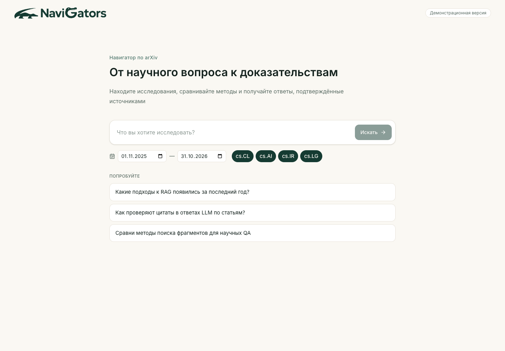
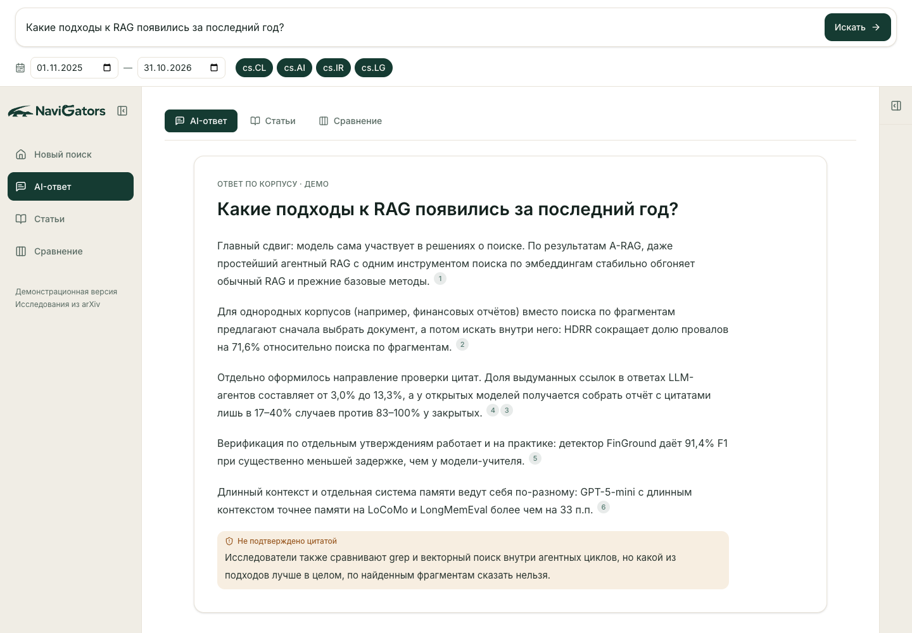
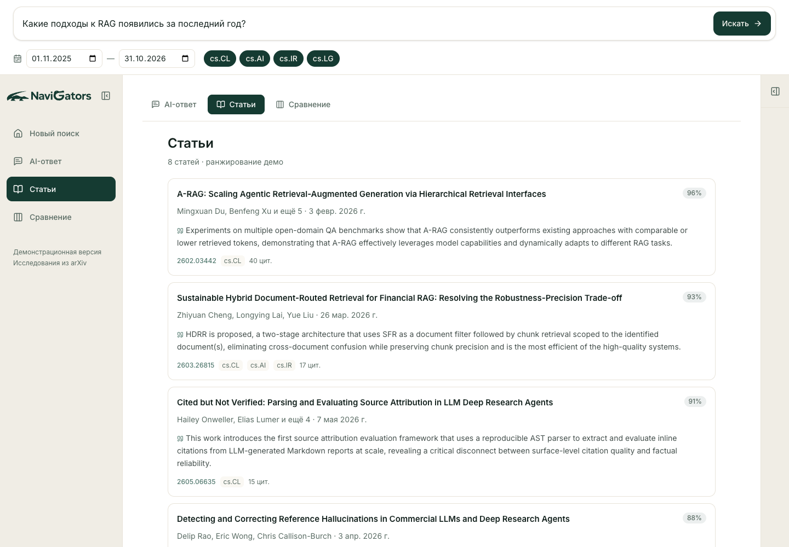
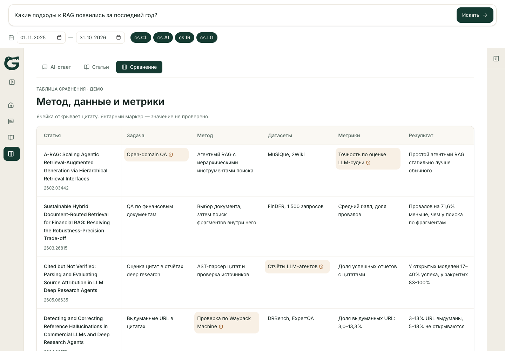
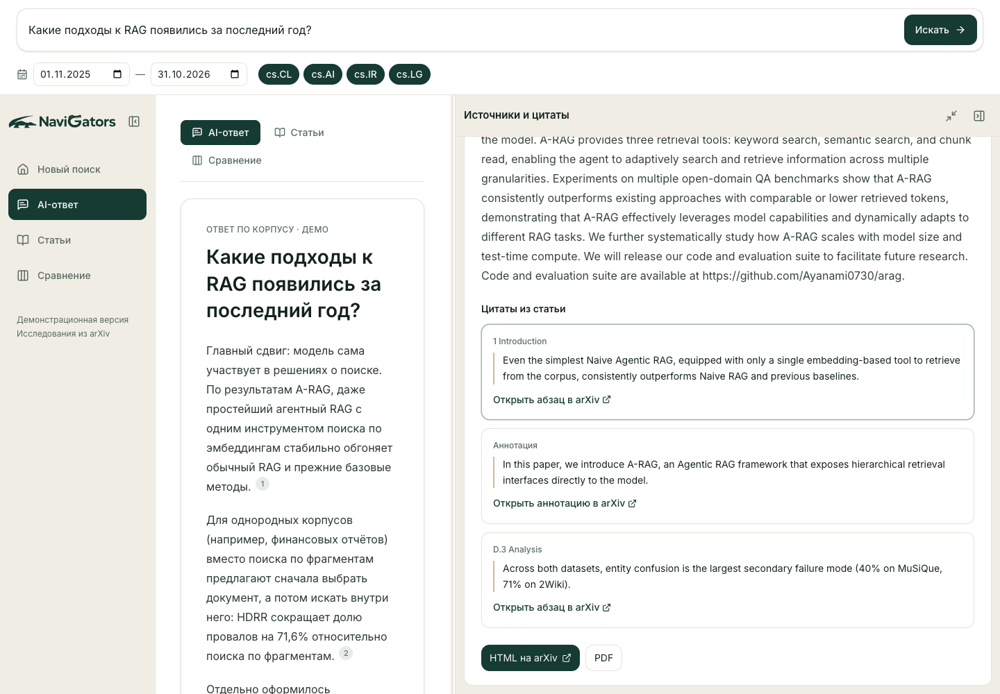

# arXiv Research Navigator

Навигатор по научным статьям: собирает статьи arXiv по теме и периоду, отвечает на вопросы
(«какие подходы к X появились за год?») и строит таблицу сравнения (метод, датасет, метрики),
где каждая ячейка подкреплена цитатой из статьи, а непроверенные значения помечены.

Финальный проект курса «Введение в LLM». Отчёт чекпоинта 1 — [docs/checkpoint1_report.md](docs/checkpoint1_report.md).

## Структура

```
config/corpus.yaml            # тема, период, категории и запросы dev-корпуса
src/navigator/collect/        # клиенты источников данных
  arxiv_api.py                #   arXiv API (метаданные) + OAI-PMH (лицензии)
  semantic_scholar.py         #   Semantic Scholar batch API (цитаты, TLDR, venue)
  fulltext.py                 #   arXiv HTML/PDF -> чанки с якорями для цитат
  eval_sets.py                #   QASPER, ArxivDIGESTables
  http.py                     #   паузы под rate limit, ретраи
scripts/collect.py            # CLI сбора данных
scripts/show_paper.py         # просмотр скачанной статьи в терминале
frontend/                     # интерфейс (React + Vite), пока на демо-данных
data/                         # см. data/STATS.md
docs/                         # отчёты по чекпоинтам, дизайн интерфейса, скриншоты
```

## Данные

В репозитории лежат только небольшие файлы: список статей корпуса (`data/processed/papers.parquet`), журнал загрузки, статистика и шаблон эталона. Полные тексты статей и эталонные датасеты в репозиторий не входят (объём и лицензии arXiv), их каждый скачивает себе сам.

| Что | Размер | Как получить | Время |
|---|---|---|---|
| Полные тексты статей и фрагменты (`data/raw/`, `data/processed/chunks.jsonl`) | около 85 МБ | `python scripts/collect.py fulltext` | около 20 минут (arXiv разрешает один запрос в 3 секунды) |
| QASPER и ArxivDIGESTables (`data/eval/`) | около 60 МБ | `python scripts/collect.py evalsets` | 1–2 минуты |

```bash
python -m venv .venv && .venv/bin/pip install -r requirements.txt
.venv/bin/python scripts/collect.py fulltext
.venv/bin/python scripts/collect.py evalsets
```

Список статей уже собран, поэтому этапы `meta` и `s2` запускать не нужно. Они заново ищут статьи в arXiv и перезаписывают `papers.parquet`, и корпус может измениться: за это время в arXiv появляются новые статьи. Команда `all` запускает все этапы подряд, включая эти два.

Этапы можно прерывать и запускать снова: `fulltext` докачивает только те статьи, файлов которых ещё нет на диске. После правок парсера фрагменты можно пересобрать из скачанных файлов без сети: `python scripts/collect.py chunks`.

Посмотреть скачанную статью в терминале (метаданные и все фрагменты по порядку):

```bash
.venv/bin/python scripts/show_paper.py 2511.21631           # текст статьи
.venv/bin/python scripts/show_paper.py 2511.21631 --urls    # со ссылкой на каждый абзац в arXiv
.venv/bin/python scripts/show_paper.py 2511.21631 --open    # открыть HTML-версию из кэша в браузере
```

Ключ Semantic Scholar (необязательно, снимает ограничение частоты запросов) задаётся в переменной окружения `S2_API_KEY`. В репозиторий его класть нельзя.

## Интерфейс

Сейчас интерфейс работает на демонстрационных данных, бэкенд и RAG к нему пока не подключены. Метаданные статей настоящие (из `data/processed/papers.parquet`), цитаты дословно взяты из их текстов, а формулировки ответа и ячеек таблицы написаны вручную для макета.

```bash
cd frontend
npm install
npm run dev
```

Откроется на http://localhost:5173 (если порт занят, Vite выберет другой и напишет об этом в терминале). Нужен Node.js 18 или новее. На главной можно ввести вопрос или выбрать подсказку, после этого откроется рабочее пространство. Проверка сборки: `npm run build`, тесты панели источников: `npm run test:panel`. Описание дизайна: [docs/design_system.md](docs/design_system.md).

Скриншоты сделаны в Chrome при разрешении 1440×1000. Логотип сделан с помощью ChatGPT, вектор в `frontend/public/brand/` перерисован по этому изображению.

### Главная страница

Поисковая строка, фильтры периода и категорий arXiv, примеры исследовательских вопросов.



### Ответ с цитатами

Ответ со ссылками на источники и отдельной отметкой утверждения, не подтверждённого цитатой.



### Список статей

Карточки с авторами, датой, кратким описанием, категориями и показателем релевантности.



### Сравнительная таблица

Задача, метод, датасеты, метрики и результат. Непроверенные значения выделены тёплым акцентом.



### Панель источников

Данные выбранной статьи, аннотация и подтверждающие цитаты. Цитата из текста статьи ведёт к своему абзацу в HTML-версии на arXiv, цитата из аннотации ведёт на страницу статьи. Кнопки внизу открывают страницу статьи (HTML-версию) и PDF на arXiv. Ответ остаётся доступным в центре.


