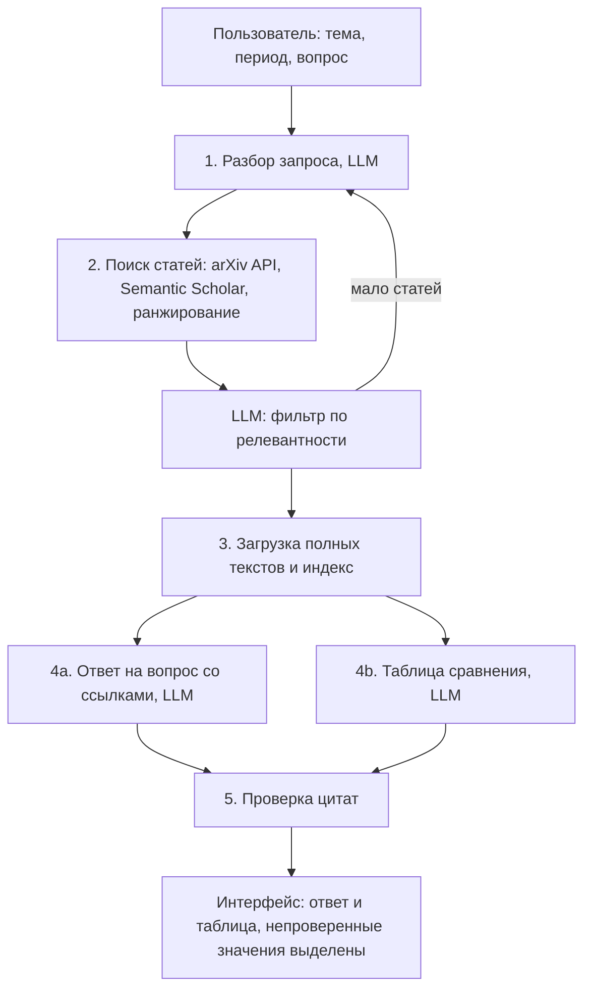

# Чекпоинт 1. Навигатор по научным статьям (arXiv Research Navigator)

**Команда:** NaviGators (Сизова Олеся, Юрина Анастасия, Эбаноидзе Илья)
**Ментор:** Анжела Шумилова
**Дата:** 17.11.2026

## 1. Описание проекта

### Проблема

Чтобы найти информацию и обновления для своего исследования или темы, приходится изучать много статей и публикаций, и на это уходит много времени. Чтобы понять, какие подходы появились за год, нужно просмотреть сотни аннотаций, открыть десятки статей и вручную свести в таблицу методы, датасеты и метрики. При этом легко пропустить важную работу.

Спросить обычный LLM-чат быстрее, но он часто придумывает статьи и цифры или отвечает без ссылок. Проверить ответ нельзя, поэтому всё равно приходится самому перечитывать статьи.

### Что делает система

Пользователь задаёт тему, период и категории arXiv. Система находит подходящие статьи, отвечает на вопросы по ним (например, «какие подходы к X появились за год?») и строит таблицу сравнения: задача, метод, датасеты, метрики, основной результат. У каждой ячейки есть цитата со ссылкой на абзац или таблицу статьи. Если значение не удалось подтвердить цитатой, ячейка помечается как непроверенная.

### Кто будет пользоваться

Система нужна всем, кто следит за научными публикациями или ищет в них ответы:

- **студенты и аспиранты**: обзор литературы для курсовой, ВКР, диссертации или семестрового проекта (мы сами в том числе);
- **исследователи**: следить за новыми работами в своей области и быстро находить, что уже сделано по теме;
- **ML-инженеры и разработчики**: выбрать подход для задачи и понять, что сейчас используют и как это оценивают;
- **аналитики и продуктовые команды**: разобраться в новой области или технологии, прежде чем принимать решение;
- **научные руководители и рецензенты**: быстро проверить, насколько работа новая и с чем её сравнивать.

Общее у них одно: им нужно быстро свести информацию из многих статей и при этом иметь возможность проверить каждое утверждение.

## 2. Роли в команде

Мы разделили проект на три зоны и распределили их на созвоне команды.

| Участник | Зона ответственности |
|---|---|
| Илья Эбаноидзе | данные и поиск: корпус, поиск статей, загрузка новых статей по запросу, индекс и поиск фрагментов, проверка цитат; оценка поиска и извлечения |
| Олеся Сизова | LLM-пайплайн: ответ со ссылками, извлечение таблицы, обзор подходов, связка шагов на LangGraph |
| Анастасия Юрина | приложение: интерфейс, разбор запроса пользователя, логирование, обработка ошибок, деплой; оценка ответов LLM и удобства интерфейса |

Эталон размечаем все вместе. Тесты и README каждый пишет для своей части.

## 3. Данные

### 3.1 Источники

| Источник | Что берём | Для чего |
|---|---|---|
| arXiv API | название, аннотация, авторы, даты, категории | поиск статей |
| HTML-версии статей arXiv | полный текст с разделами, абзацами и таблицами | основной источник текста; у каждого абзаца есть идентификатор, поэтому ссылка ведёт прямо на него |
| PDF-версии статей arXiv | полный текст | если HTML-версии нет; ссылка ведёт только на страницу |
| arXiv OAI-PMH | лицензия статьи | понять, какие тексты можно показывать полностью |
| Semantic Scholar API | число цитирований, место публикации, краткое содержание | ранжирование статей |
| QASPER | 1 585 статей по NLP, 5 049 вопросов с ответами и фрагментами, где находится ответ | оценка ответов на вопросы и ссылок |
| ArxivDIGESTables | 2 228 таблиц сравнения из обзорных статей и 7 542 статьи из этих таблиц | оценка таблиц сравнения |

Все источники открыты. arXiv просит делать не больше одного запроса в 3 секунды, поэтому полные тексты скачиваются медленно.

### 3.2 Собранный корпус

Для разработки мы собрали корпус по теме «RAG и LLM-агенты» за период с 01.11.2025 по 31.10.2026, категории `cs.CL`, `cs.AI`, `cs.IR`, `cs.LG`. В готовом приложении тему и период будет задавать пользователь. Поисковые запросы лежат в [config/corpus.yaml](../config/corpus.yaml).

| Что | Объём |
|---|---|
| Статьи с метаданными | 3 672 |
| Найдены в Semantic Scholar | 3 669 |
| Статьи с полным текстом | 440 (200 самых цитируемых и 240 случайных): 428 из HTML, 11 из PDF, 1 недоступна, так как её отозвали авторы |
| Фрагменты текста | 43 840: 40 007 абзацев, 3 405 таблиц, 428 аннотаций |
| Статьи под лицензией Creative Commons | 274 из 440 (62%) |
| Объём на диске | около 150 МБ вместе с QASPER и ArxivDIGESTables |

Подробная статистика по месяцам, запросам и лицензиям: [data/STATS.md](../data/STATS.md).

### 3.3 Что мы заметили при сборе

В первой версии корпуса основной запрос по RAG был ограничен 1 000 статей. arXiv отдаёт результаты от новых к старым, а всего статей по запросу 2 244, поэтому в корпус попали только статьи с мая по октябрь 2026. Мы увеличили ограничение до 3 000 и собрали корпус заново. В приложении при большом числе результатов статьи нужно будет отбирать по всему периоду, а не только самые свежие.

В HTML около четверти абзацев вложены в другие абзацы (пункты списков, теоремы), и сначала их текст попадал в корпус дважды. Мы это исправили.

Цитирований у свежих статей мало (медиана 1), поэтому одной цитируемости для ранжирования недостаточно. Кроме того, по запросам находятся статьи, где тема упоминается вскользь. Например, по запросу про длинный контекст и поиск нашёлся технический отчёт Qwen3-VL (3 246 цитирований), хотя он про другое. Значит, после поиска нужна фильтрация по релевантности.

### 3.4 Формат хранения

```
data/
├── raw/                      # скачанные файлы: ответы arXiv API, HTML, PDF
├── processed/
│   ├── papers.parquet        # статьи: метаданные arXiv и Semantic Scholar
│   ├── chunks.jsonl          # фрагменты текста со ссылками на место в статье
│   └── fulltext_log.jsonl    # что скачано, в каком формате, лицензия
├── eval/                     # QASPER и ArxivDIGESTables
├── gold/gold_template.csv    # шаблон нашего эталона на 50 статей
└── STATS.md
```

Пример фрагмента:

```json
{"arxiv_id": "2511.21631", "chunk_id": "2511.21631#S3.SS2.SSS1.p1", "type": "paragraph",
 "section": "3.2.1 Image Caption and Interleaved Text-Image Data",
 "url": "https://arxiv.org/html/2511.21631#S3.SS2.SSS1.p1",
 "text": "To build a robust foundation model for general-purpose vision–language understanding, we ..."}
```

По `url` статья открывается сразу на этом абзаце.

Полные тексты в репозиторий не кладём из-за объёма и лицензий: каждый участник скачивает их командой `python scripts/collect.py fulltext` (около 85 МБ, примерно 20 минут), эталонные датасеты командой `python scripts/collect.py evalsets` (около 60 МБ). Подробности в [README](../README.md).

## 4. Подход и архитектура

### 4.1 Выбор подхода

Мы выбрали RAG по полным текстам статей в виде воркфлоу на LangGraph.

Передать модели только аннотации не получится: в них обычно нет датасетов и цифр. Полные тексты десятков статей не помещаются в контекст. Агент со свободным выбором действий здесь тоже не нужен: шаги задачи известны заранее, а агент менее предсказуем и его сложнее оценивать. В воркфлоу у каждого шага понятный вход и выход, и качество можно измерить для каждого шага отдельно.

Единственное место, где система сама решает, что делать дальше: если подходящих статей нашлось слишком мало, модель переформулирует запрос (не больше двух раз).

### 4.2 Схема



### 4.3 Компоненты

| Компонент | Что делает | Как планируем делать |
|---|---|---|
| Разбор запроса | из текста пользователя получает тип запроса, поисковые запросы на английском, период и колонки таблицы | LLM, структурированный вывод через Pydantic |
| Поиск статей | находит и ранжирует статьи | arXiv API, Semantic Scholar, мультиязычные эмбеддинги (запросы на русском, статьи на английском), cross-encoder |
| Загрузка и индекс | скачивает статьи, режет на фрагменты, строит индекс | скачивание и разбор уже написаны; индекс BM25 и эмбеддинги |
| Ответ на вопрос | отвечает по найденным фрагментам со ссылками на них | LLM |
| Таблица сравнения | для каждой ячейки находит значение и цитату | LLM, структурированный вывод; фрагменты ищем отдельно под каждую колонку |
| Проверка цитат | проверяет, что цитата есть в статье и подтверждает значение | сначала проверка кодом, потом NLI-модель или LLM |
| Интерфейс | форма запроса, ответ, таблица со ссылками | Streamlit или Gradio |

LLM подключаем через API курса (Qwen через neuraldeep). Логируем промпты, время ответа и число токенов.

## 5. План оценки

Будем оценивать отдельно поиск и ответы, чтобы понимать, где теряется качество. Для сравнения возьмём LLM без поиска и простой RAG без проверки цитат.

| Что проверяем | Метрика | Данные |
|---|---|---|
| Поиск статей | Recall@20 | ArxivDIGESTables: по подписи таблицы ищем среди 7 542 статей датасета (по названию и аннотации) те, что в этой таблице сравниваются. Наш корпус для этого не подходит: статьи датасета старше |
| Поиск фрагментов | Evidence Recall@k: попал ли нужный фрагмент в первые k | QASPER, тестовая часть: подвыборка около 300 вопросов из 1 352 вопросов с ответом (чтобы уложиться в лимиты API) |
| Ответы на вопросы | Answer F1 (метрика QASPER) | QASPER |
| Точность извлечённых значений | Precision, Recall, F1 по ячейкам таблицы | наш эталон: 50 статей × 5 полей (задача, метод, датасеты, метрики, результат); [шаблон](../data/gold/gold_template.csv), [инструкция](annotation_guide.md) |
| Подтверждённость цитатами | доля утверждений, подтверждённых цитатой | ответы на 30 вопросов по нашему корпусу и ячейки таблиц из эталона |
| Удобство | смогли ли люди без подсказок выполнить задание | 5 человек, не знакомых с проектом |

Для текстовых полей (метод, результат) совпадение с эталоном будем проверять через LLM. Чтобы убедиться, что такой оценке можно доверять, сравним её с ручной разметкой на 50 примерах. 10 статей эталона размечают два человека, по ним посчитаем согласие разметчиков.

## 6. Что уже сделано

- Написан код сбора данных: arXiv API, лицензии, Semantic Scholar, загрузка эталонных датасетов.
- Написан разбор HTML и PDF на фрагменты со ссылками на место в статье.
- Собраны корпус и эталонные датасеты. Проверили, что повторяющихся фрагментов нет и ссылки ведут на существующие абзацы (100 случайных из 100).
- Подготовлены шаблон нашего эталона и инструкция для разметки.
- Сделан макет интерфейса на демонстрационных данных: поиск, ответ со ссылками, список статей, таблица сравнения с пометкой непроверенных значений (папка `frontend/`, скриншоты в [README](../README.md)). Бэкенд пока не подключён.

## 7. Открытые вопросы и блокеры

- **Скорость загрузки.** Из-за ограничения arXiv статья скачивается около 3 секунд (так шла загрузка 440 статей), то есть 50 новых статей занимают 2–3 минуты. Будем сохранять скачанные статьи, а для демонстрации загрузим корпус заранее.
- **Лицензии.** 38% статей не под Creative Commons. Планируем показывать из них только короткие цитаты со ссылкой на оригинал. *Вопрос ментору: достаточно ли этого?*
- **Разные названия одного и того же** (`HotpotQA` и `Hotpot QA`, `EM` и `Exact Match`) мешают считать F1. Сделаем словарь синонимов. *Вопрос ментору: можно ли использовать оценку через LLM как основную метрику, если мы проверяем её на ручной разметке?*
- **Объём разметки.** На 50 статей уйдёт около 8 часов суммарно (по 10 минут на статью), то есть около трёх часов на каждого. *Вопрос ментору: достаточно ли 50 статей?*
- **Ограничения API курса** на длину контекста и число запросов. Проверим на прототипе.

## 8. План до чекпоинта 2

1. Индекс и поиск фрагментов, первая метрика на QASPER.
2. Простая рабочая версия: вопрос, поиск фрагментов, ответ со ссылками.
3. Извлечение таблицы и проверка цитат, первые метрики на эталоне.
4. Разметка эталона.
5. Подключить интерфейс к рабочему конвейеру вместо демонстрационных данных.
6. Публичный репозиторий на GitHub.
